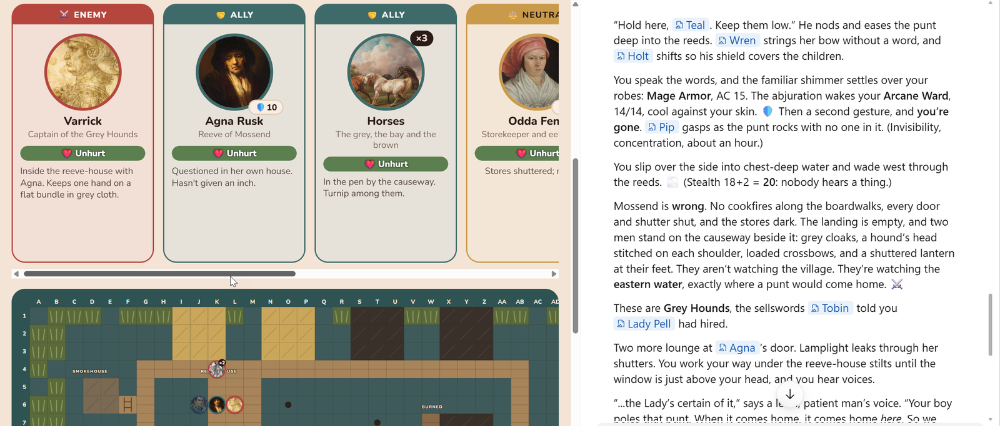
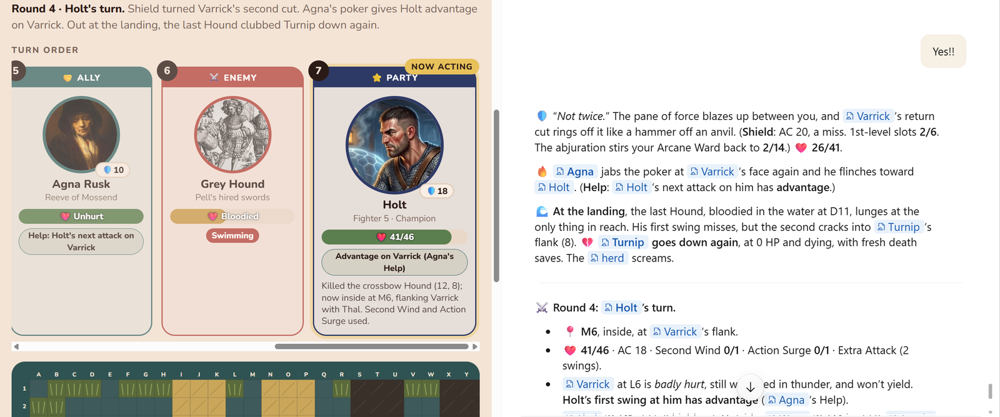
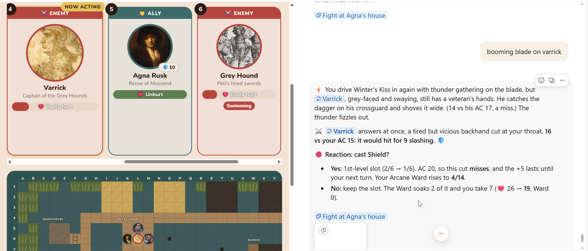
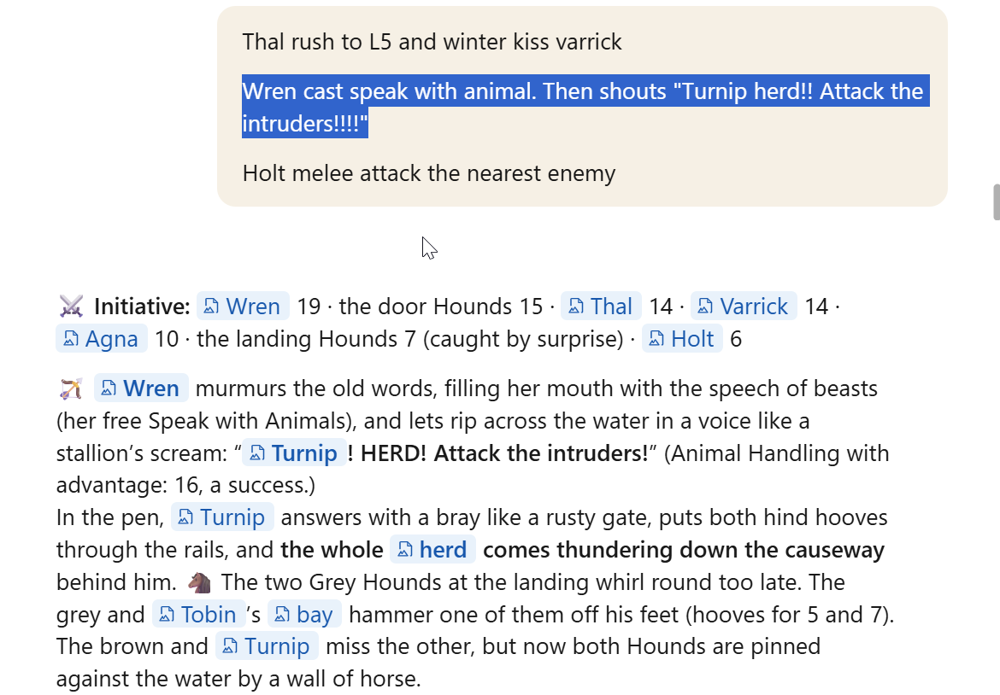
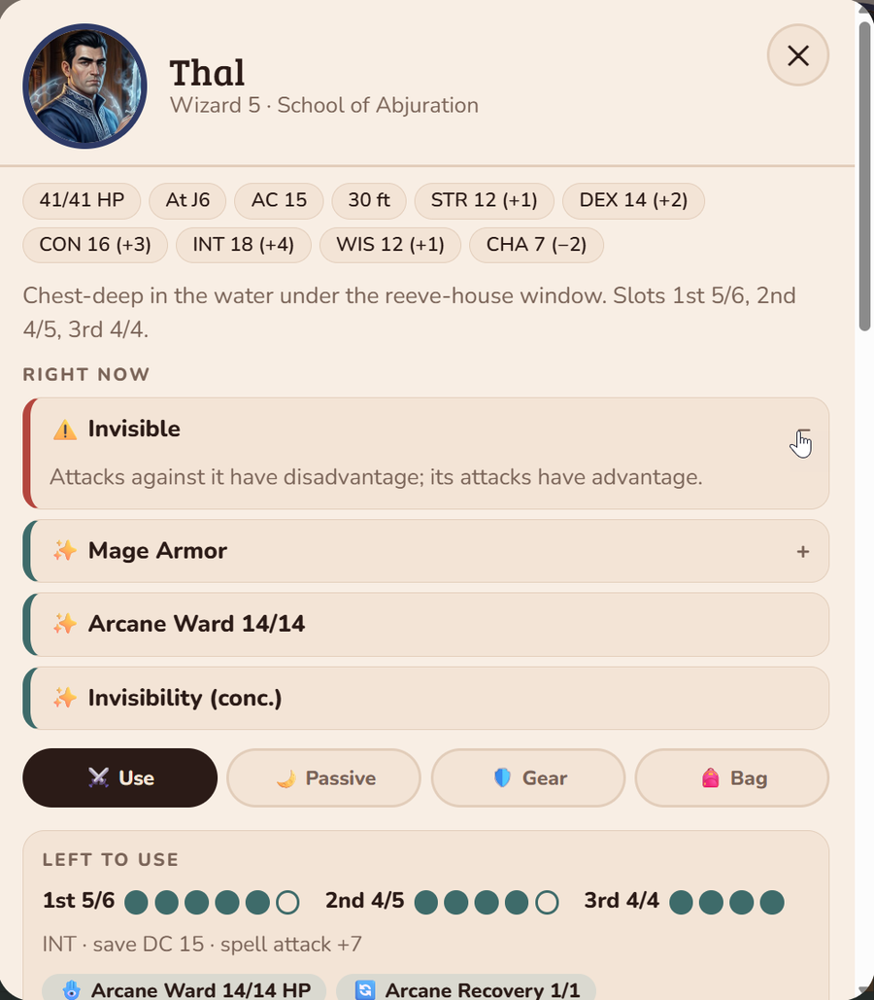
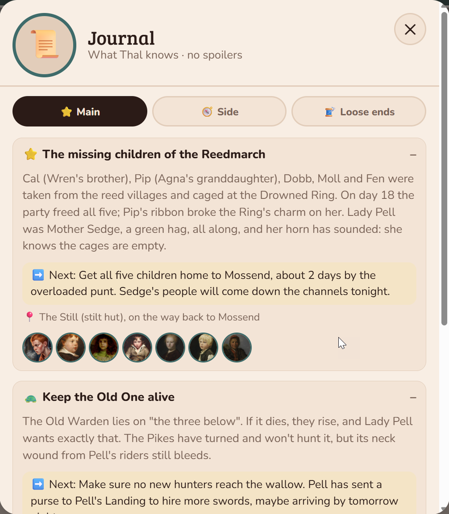
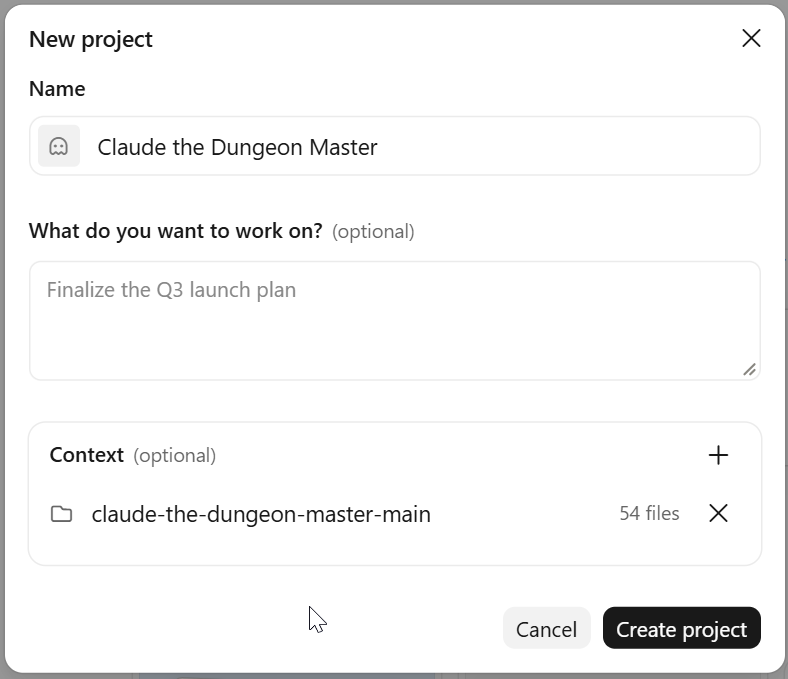
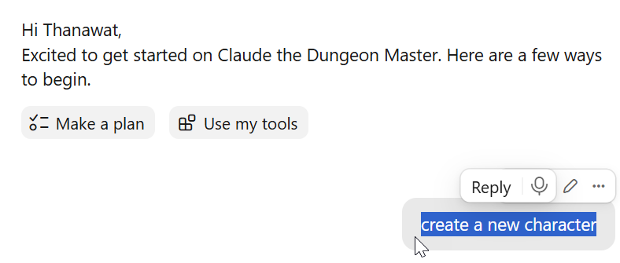

# Claude the Dungeon Master 🐉

**A solo fifth-edition campaign kit with Claude as your Dungeon Master.** Paste one set of instructions into a Claude project and get a DM that keeps the story on track, plays by the rules, and draws a live scene map for every fight and scene.



## See it in play 🎬

**Story.** Claude narrates in character, links every name to its portrait, and keeps the scene map beside the story in exploring mode.

**Combat.** The turn-order strip shows who's acting. Your party's HP, slots and position are exact, and foes only show "Bloodied" or "Badly hurt". Claude stops on each of your characters' turns and waits for your order.



**Rules and reactions.** When an attack would hit and you have a reaction like Shield, Claude stops and asks before resolving it.



**Play it your way.** Anything your characters could try, you can try. Here Wren uses Speak with Animals to rally the party's mule Turnip and the horses, and the herd charges the Grey Hounds.



<br>

<table>
<tr>
<td width="50%" valign="top"></td>
<td width="50%" valign="top"></td>
</tr>
</table>

Tap any character for their panel (spells, abilities, gear and bag), or open the journal to see your quests and what to do next.

## What you get

- 🗺️ **Scene map** for every fight and scene: a top-down 5 ft grid with named squares (C10), terrain and a legend, portrait cards, and a built-in quest journal. **Combat mode** shows turn order and who's acting; **exploring mode** shows who's in the scene.
- 📜 **Main quests with direction:** by default every main quest has 3 stages and at least one twist, the first is about your hero, and later ones are about a companion or familiar. Before each one, Claude interviews you (you can change any of these defaults there) and drafts the whole quest in a hidden DM file, so the story never drifts.
- 📖 **Quest journal** to track your quests: main quests, side quests and loose ends, each with what you know so far, the next step, where it leads and who's involved. Finished quests fold into Done, chapter by chapter. It's built into every scene map, and it only holds what your character knows, so there are no spoilers.
- 🧵 **Thread naming** that tracks where you are: `1.3.2. Thal at Coldhearth` = main quest 1, stage 3, episode 2.
- ⚔️ **Turn-by-turn combat:** your party acts one character at a time, and Claude waits for your orders. Enemies act on their own.
- ⚖️ **Rules kept honest:** 5e 2014 (SRD 5.1). Anything illegal is flagged before the roll, with legal options.
- 📋 **Party state file:** one JSON file holds HP, slots, resources and positions, and the map is built from it.
- 🖼️ **Portraits for every character:** Claude finds one on the internet (public-domain paintings or freely licensed photos, with credits), or you give it a picture you found or made yourself. For important NPCs, Claude shows a few options for you to pick from. Each portrait is reused whenever that character returns, it's their token on the map, and every name in the story links to it.
- 🎚️ **Level-up interviews:** Claude never picks your choices for you.
- ✅ **A pre-post checklist** Claude runs before every story post.

## Quick start 🚀

**1. Download the kit.** On this page, click the green **Code** button, then **Download ZIP**. Unzip it. You'll get a folder called `claude-the-dungeon-master-main`.

**2. Create a project in [Claude](https://claude.ai).** Open **Projects**, click **New project**, and:
- **Name:** anything you like, e.g. *Claude the Dungeon Master*.
- **Context:** click **+** and add the unzipped `claude-the-dungeon-master-main` folder.
- Click **Create project**.

<p align="center"></p>

For the best results, also paste the text of [`project-instructions.md`](project-instructions.md) into the project's instructions, so Claude follows them in every chat. Make sure Artifacts and code execution are turned on, because the scene map needs them.

**3. Start your first chat.** Type:

> **Let's create a new character.**

Claude will build your hero with you step by step, then interview you about main quest 1. After that, the adventure begins.

<p align="center"></p>

## How a campaign runs

```
interview → hidden draft → stage 1 → stage 2 → stage 3 → interview → next main quest …
```

Each stage is played in one or more story threads, named `MainQuest.Stage.Running Name`. See [`guides/main-quests.md`](guides/main-quests.md).

## Make it yours

- **House rules:** none are built in. Add yours to [`house-rules.md`](house-rules.md); it ships with *flammable grease* as an example you can edit or delete.
- **Portraits:** bring your own pictures for your characters ([`guides/portraits.md`](guides/portraits.md)).
- **Anything else:** the instructions are plain text. Change what you like.

## What's inside

| Path | What it is |
| --- | --- |
| `project-instructions.md` | The DM's standing rules (paste into your project) |
| `house-rules.md` | Your house rules, with one example |
| `guides/` | Main quests, portraits, level-ups |
| `templates/` | Blank party state, journal, character panels, scene, campaign log, sheets, and the DM-only main quest plan |
| `scene-map/` | The map page, its build script and field reference |
| `tools/crop_portrait.py` | Crops any picture to a 1020x960 portrait |
| `examples/thal/` | A real campaign in progress: Thal, Wren and Holt |

## Credits and licences

Made by **Thanawat Laohadtanaphorn**. Code is MIT; instructions, guides, templates and sample material are CC BY 4.0. Sample NPC portraits are public-domain or freely licensed works from Wikimedia Commons, credited in [`examples/thal/portraits/index.md`](examples/thal/portraits/index.md). Includes material from the SRD 5.1 by Wizards of the Coast LLC (CC BY 4.0). See [`NOTICE.md`](NOTICE.md).

Unofficial fan content, not affiliated with or endorsed by Wizards of the Coast or Anthropic.
